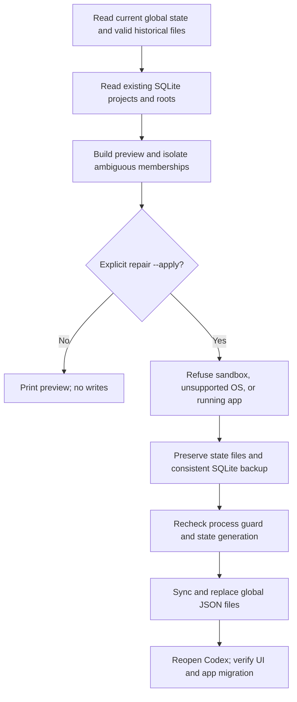

# How recovery works

This is a Windows desktop workaround for a specific class of local project-registry failures, not an official Codex API integration.

## Evidence and limits

The original incident involved NUL bytes in the primary global-state JSON and its immediate `.bak`, alongside Windows unclean-shutdown events. Installed application code fell back to empty state when both JSON files failed. That observation motivated historical backups independent of the application's immediate backup.

This repository intentionally excludes the original logs, names, paths, snapshots, databases and account information. It does not assert that all missing-project incidents have the same cause, or that an upstream fix has or has not shipped.

## State model

- Default home: `CODEX_HOME` when defined, otherwise `~/.codex`.
- Expected database: `state_5.sqlite`. The tool opens it with `mode=ro` and checks integrity before planning.
- Expected tables: `projects`, `project_roots`, `threads`, using columns referenced in the source.
- Writable application files: `.codex-global-state.json` and `.codex-global-state.json.bak`, plus unique temporary files in their directory.
- `app-server-project-id-by-legacy-project-id-by-host` retains known legacy/server ID mappings.
- The recovery sets the local assignment-migration checkpoint to pending so the application can process recovered memberships after reopening. Successful file replacement does not prove that a future application version accepts or migrates them.

Existing SQLite membership has priority, followed by explicit historical membership. A unique exact folder match is an **inference**. Multiple projects sharing one folder remain ambiguous; chronological guesses are deliberately excluded. Subagents, existing current assignments and explicitly projectless conversations are not reassigned.

Historical candidate selection ranks valid state objects by project count, assignment count and modification time. An old candidate can contain stale metadata or associations. The preview and explicit apply step are essential. Current project records and current preferences are preserved when rebuilding.

## Write and backup semantics

Writes use unique temporary files, `flush`, `os.fsync` and `os.replace`. Each JSON is replaced individually; the two-file update is **not** an atomic transaction. Power loss or interference can still cause a partial update. The complete pre-repair state is retained in a timestamped directory for investigation.

Before committing, the tool compares the primary state bytes against the generation used during preparation. This reduces concurrency risk; there is no application-wide lock, so users must close all writers. `ChatGPT.exe` and `codex.exe` are conservatively treated as blockers. Sandbox process enumeration can hide the real app, so recognized Codex sandbox environments are refused.

Backups use SQLite's backup API, not a raw copy of an open WAL database. The original database is never updated by the tool. Connections close explicitly. Backup output contains private metadata and must remain outside the public repository. The tool does not use networking, access browser storage, load credential files, restore databases automatically, or schedule tasks silently.

## Support expectations

Version 0.1.0 is experimental. Test fixtures cover the supported schema, not every Codex release, damaged database, remote project or account migration. Unknown schemas require review. An empty registry may also be intentional; watch mode does not restore it automatically.
